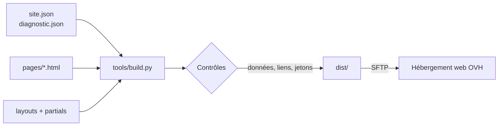

# Site AMI TECH

Site vitrine d'AMI TECH (nom commercial d'AMIPROTEK SAS), entreprise de services informatiques basée à Irigny (69) : dépannage, réseau, serveurs NAS, vidéosurveillance, alarme, téléphonie IP et sécurité des données.

Le site remplace l'ancienne version Wix. Il est statique, rapide, sans cookie ni traceur, et comprend un **diagnostic guidé** qui oriente le visiteur vers la bonne prestation selon son problème.

## Fonctionnalités

- **Accueil animé** : une baie de brassage dont chaque port mène à un service. Au chargement, les câbles se branchent un par un et les voyants de liaison s'allument. L'animation est désactivée si le visiteur a activé « réduire les animations » dans son système.
- **Diagnostic guidé** : un arbre de questions (PC lent, plus d'internet, virus, données perdues, etc.) qui aboutit à une prestation, son prix, les bons réflexes et un e-mail pré-rempli. Il fonctionne entièrement dans le navigateur ; aucune réponse n'est transmise.
- **Pages** : services, nos chantiers (galerie photo avec visionneuse), diagnostic, tarifs, protection antivirus, mentions légales, confidentialité et page 404.
- **Thème sombre** automatique selon les préférences du système.
- **Accessibilité** : navigation au clavier, lien d'évitement, gestion du focus dans le diagnostic, contrastes vérifiés.
- **Sécurité** : politique CSP stricte, aucun script ni style en ligne, aucune ressource tierce, police auto-hébergée (conformité RGPD).

## Architecture

```text
amiprotek-site/
├── src/
│   ├── site.json             # Coordonnées, services, tarifs, mentions légales
│   ├── data/diagnostic.json  # Arbre de décision du diagnostic
│   ├── layouts/base.html     # Gabarit commun (head, en-tête, pied de page)
│   ├── partials/             # Fragments : header.html, footer.html
│   ├── pages/                # Une page = un fichier HTML avec en-tête meta
│   ├── assets/               # CSS, JS, images, polices
│   ├── data/infections.json  # Compteur antivirus (mis à jour chaque jour)
│   ├── data/redirects.json   # Anciennes adresses Wix -> nouvelles pages
│   └── server/htaccess.conf  # Modèle du .htaccess (OVH : sécurité, HTTPS, redirections)
├── tools/
│   ├── build.py              # Générateur du site (bibliothèque standard)
│   └── fetch_fonts.py        # Téléchargement de la police à auto-héberger
├── tests/test_build.py       # Tests unitaires et tests du site généré
└── dist/                     # Site généré (non versionné)
```



Le générateur remplace les jetons `{{ site.contact.email }}` (valeur échappée), `{{> header }}` (fragment) et `{{@ tarifs_table }}` (bloc produit à partir des données). Il refuse de produire le site si une variable est inconnue, si l'arbre du diagnostic pointe vers une question inexistante ou si un lien interne est cassé.

### Pourquoi pas de framework

Pour un site d'une dizaine de pages, un framework JavaScript ajouterait des centaines de dépendances npm à maintenir et à surveiller, sans bénéfice pour le visiteur. Ici, le build ne dépend que de Python et le site final ne contient que du HTML, du CSS et deux petits scripts.

## Prérequis

- Python 3.10 ou supérieur
- Git

Aucune bibliothèque Python n'est nécessaire pour construire le site. `ruff` sert uniquement au contrôle de style.

## Installation

```bash
git clone https://github.com/alexisbouchet6-del/amiprotek-site.git
cd amiprotek-site
python tools/fetch_fonts.py
```

Le script `fetch_fonts.py` télécharge une seule fois la police Archivo dans `src/assets/fonts/`. Committez ensuite ce fichier et sa licence : le site n'appellera plus jamais Google Fonts.

## Utilisation

Construire puis afficher le site en local :

```bash
python tools/build.py
python -m http.server 8000 -d dist
```

Ouvrez ensuite <http://localhost:8000>.

Lancer les tests et le contrôle de style :

```bash
python -m unittest discover -s tests -v
python -m pip install ruff
ruff check tools tests
```

Options du build :

| Option | Effet |
|---|---|
| `--strict` | Échoue si une mention légale ou la mention TTC/HT manque. À utiliser pour la mise en production. |
| `--preview` | Charge la police depuis Google Fonts. Réservé aux aperçus, jamais en production. |

## Modifier le contenu

| Pour modifier… | Éditez… |
|---|---|
| Le nom de l'entreprise | `src/site.json`, clé `name` : titres, en-tête, pied de page et mentions sont mis à jour au build |
| Téléphone, e-mail, adresse | `src/site.json`, bloc `contact` |
| Un service (texte, points, marques, couleur de câble) | `src/site.json`, bloc `services` |
| Un prix | `src/site.json`, bloc `tarifs` (champs `pro` en HT et `part` en TTC) ; le diagnostic se met à jour automatiquement |
| Les conditions d'intervention | `src/site.json`, bloc `conditions` |
| Une question ou un résultat du diagnostic | `src/data/diagnostic.json` |
| Les mentions légales | `src/site.json`, bloc `legal` |

### Changer les images des services

Déposez une image par service dans `src/assets/img/offres/`, nommée d'après l'identifiant du service :

| Service | Fichier |
|---|---|
| Infrastructure réseau | `reseau.jpg` |
| Serveur NAS | `nas.jpg` |
| Vidéosurveillance et alarme | `videosurveillance.jpg` |
| Maintenance informatique | `maintenance.jpg` |
| Internet et téléphonie | `telephonie.jpg` |
| Sécurité des données | `securite.jpg` |

Les formats `.webp`, `.jpg`, `.png` et `.avif` sont acceptés. Le build détecte la photo automatiquement et l'affiche sur l'accueil et sur la page Services. Recommandations : format paysage 4:3, 1600 px de large, moins de 300 Ko. Tant qu'une photo manque, un emplacement réservé s'affiche ; en production (`--strict`), il ne montre que le pictogramme du service.

### Ajouter des photos de chantier (page « Nos chantiers »)

La page `chantiers.html` présente vos vraies photos d'installation, classées par service (mêmes catégories que la page Services). Une catégorie sans photo n'apparaît pas en production.

1. Installez Pillow une seule fois (uniquement pour ce script) : `python -m pip install Pillow`
2. Lancez, avec l'identifiant du service (`reseau`, `nas`, `videosurveillance`, `maintenance`, `telephonie`, `securite`) :
   ```bash
   python tools/prepare_photos.py videosurveillance ~/Images/portail.jpg ~/Images/camera.jpg
   ```
   Le script redresse les photos, **supprime leurs métadonnées (dont la position GPS du téléphone)**, les redimensionne et crée une vignette. Les fichiers sont numérotés à la suite des photos existantes dans `src/assets/img/chantiers/<service>/`.
3. Facultatif : ajoutez une légende dans `src/data/chantiers.json`, par exemple `"videosurveillance/09.jpg": "Caméra sur mât, parking d'entreprise"`.

Avant de publier une photo : aucune personne reconnaissable sans son accord écrit, aucun nom, adresse, plaque ou numéro lisible, aucun écran affichant les données d'un client.

### Compteur antivirus (mise à jour automatique)

La page `antivirus.html` et les résultats du diagnostic liés aux virus affichent le nombre de postes infectés pris en charge sur les 7 derniers jours dont l'antivirus n'était pas actif. Ce chiffre est recalculé **chaque jour** par le workflow `.github/workflows/antivirus-compteur.yml`, à partir du registre de l'atelier.

1. Tenez un registre (Google Sheets ou Excel en ligne) avec une ligne par poste infecté pris en charge, sur le modèle de `docs/modele-registre-infections.csv` : colonnes `date` (AAAA-MM-JJ ou JJ/MM/AAAA) et `antivirus_actif` (`oui` / `non`).
2. Publiez la feuille au format CSV (Google Sheets : Fichier > Partager > Publier sur le Web > format CSV).
3. Dans GitHub : Settings > Secrets and variables > Actions > New repository secret, nom `REGISTRE_CSV_URL`, valeur = l'adresse CSV publiée.

**Le CSV publié est lisible par toute personne qui connaît son adresse : n'y mettez aucun nom de client ni donnée personnelle.** Gardez le détail des interventions dans un autre onglet non publié.

Le résultat est enregistré dans `src/data/infections.json` (modifiable à la main si besoin). L'encadré est masqué si le compteur est vide, vaut 0 ou date de plus de 7 jours.

Sous ce compteur, la page affiche un **chiffre national annuel** sourcé (`src/site.json`, bloc `antivirus.national`). À mettre à jour chaque année à la parution du rapport d'activité de Cybermalveillance.gouv.fr (fin mars), en changeant la valeur, l'année, la source et le lien.

### Ajouter des avis Google

Les avis sont saisis dans `src/site.json`, bloc `reviews` : le site ne charge aucun script Google, ne dépose aucun cookie et reste rapide.

| Champ | Contenu |
|---|---|
| `google_url` | Lien de votre fiche Google (« Voir tous nos avis ») ; chaque avis du carrousel y renvoie |
| `write_url` | Lien « Laisser un avis » fourni par Google Business Profile |
| `rating`, `count` | Note moyenne et nombre d'avis affichés sur votre fiche (à mettre à jour) |
| `items` | 5 à 10 avis : `author`, `rating` (1 à 5), `date` (`AAAA-MM`), `text`, `url` (optionnel) |

La date de chaque avis est obligatoire (article L111-7-2 du Code de la consommation). La mention indiquant que les avis sont sélectionnés et non vérifiés est générée automatiquement.

Chaque résultat du diagnostic peut référencer des tarifs (`"tarifs": ["ssd"]`) et un service (`"service": "maintenance"`) par leur identifiant. Les tests vérifient que chaque question est accessible et que chaque référence existe.

## Déploiement (hébergement web OVH)

Le site est statique : il fonctionne sur toutes les offres d'hébergement web OVH, sans PHP ni base de données. Le build génère un fichier `.htaccess` (en-têtes de sécurité, HTTPS obligatoire, adresse avec « www », redirections des anciennes adresses Wix, page 404).

La mise en ligne est automatique (workflow `.github/workflows/deploy-ovh.yml`) : à chaque modification poussée sur `main` et après chaque mise à jour du compteur antivirus. Configuration, une seule fois :

1. Espace client OVH : Web Cloud > Hébergements > votre offre > onglet **FTP - SSH**. Notez le serveur SFTP et cochez **SFTP** pour l'utilisateur. Utilisez un utilisateur dont le dossier racine ne contient que le site.
2. Depuis un PC, récupérez l'empreinte du serveur (à vérifier une fois avec FileZilla, qui affiche la même empreinte à la première connexion) :
   ```bash
   ssh-keyscan -p 22 ftp.clusterXXX.hosting.ovh.net
   ```
3. Dans GitHub : Settings > Secrets and variables > Actions, créez les secrets `OVH_SFTP_HOST`, `OVH_SFTP_USER`, `OVH_SFTP_PASSWORD`, `OVH_SFTP_KNOWN_HOSTS` (sortie complète de la commande ci-dessus) et, si le dossier n'est pas `www`, `OVH_SFTP_PATH`.
4. Lancez une première fois le workflow (onglet Actions > Déploiement OVH > Run workflow) et testez le site à l'adresse provisoire de l'hébergement.
5. Après validation par la direction seulement : dans l'espace client OVH, onglet **Multisite**, ajoutez `ami-tech.fr` et `www.ami-tech.fr` (dossier `www`), ainsi que `amiprotek.fr` et `www.amiprotek.fr` (même dossier : le `.htaccess` les redirige vers `https://www.ami-tech.fr`, page par page). Modifiez ensuite les enregistrements **A et AAAA** des deux domaines vers l'adresse IP de l'hébergement, **sans toucher aux enregistrements MX** (les e-mails passent par Mailinblack). Activez enfin le certificat SSL gratuit (Let's Encrypt) pour les quatre adresses et vérifiez les en-têtes de sécurité, par exemple avec <https://securityheaders.com>.

Tant que les secrets ne sont pas créés, le workflow s'exécute sans rien envoyer. L'envoi ne supprime aucun fichier sur l'hébergement.

### Aperçu GitHub Pages

Un aperçu public, non indexé par les moteurs de recherche, est publié par `.github/workflows/pages.yml` (Settings > Pages > Source : GitHub Actions). Il peut être désactivé après la mise en ligne chez OVH.

## Avant la mise en ligne

- [x] Mentions légales renseignées à partir du registre national des entreprises (SIREN 817 637 390).
- [x] Grille tarifaire 2026 : prix TTC pour les particuliers, HT pour les professionnels.
- [x] Capital social renseigné (2 500 €, capital fixe).
- [ ] Vérifier le numéro de téléphone d'OVH dans les mentions légales (`legal.hebergeur_contact`).
- [ ] Configurer les secrets OVH et le registre du compteur antivirus.
- [x] Police Archivo auto-hébergée et committée.
- [x] Textes et tarifs validés par la direction (octobre 2026).
- [ ] Souscrire l'hébergement web OVH, rattacher les domaines ami-tech.fr et amiprotek.fr, activer le SSL.

## Conventions

- Commits au format [Conventional Commits](https://www.conventionalcommits.org/fr/) : `feat:`, `fix:`, `docs:`, `style:`, `refactor:`, `test:`, `ci:`.
- La CI (GitHub Actions) exécute la recherche de secrets, le contrôle de style, les tests et le build à chaque push et pull request.
- Aucun secret dans le dépôt : le site n'en utilise aucun.

## Licence

Tous droits réservés, AMIPROTEK. Voir [LICENSE](LICENSE).
