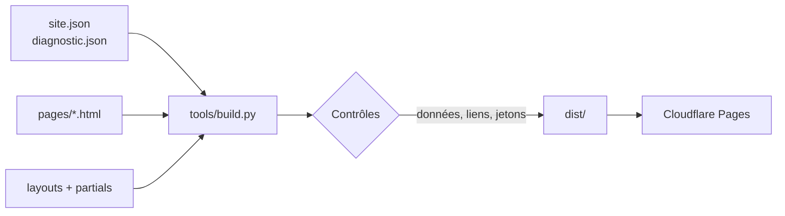

# Site AMI TECH

Site vitrine d'AMI TECH (nom commercial d'AMIPROTEK SAS), entreprise de services informatiques basée à Irigny (69) : dépannage, réseau, serveurs NAS, vidéosurveillance, alarme, téléphonie IP et sécurité des données.

Le site remplace l'ancienne version Wix. Il est statique, rapide, sans cookie ni traceur, et comprend un **diagnostic guidé** qui oriente le visiteur vers la bonne prestation selon son problème.

## Fonctionnalités

- **Accueil animé** : une baie de brassage dont chaque port mène à un service. Au chargement, les câbles se branchent un par un et les voyants de liaison s'allument. L'animation est désactivée si le visiteur a activé « réduire les animations » dans son système.
- **Diagnostic guidé** : un arbre de questions (PC lent, plus d'internet, virus, données perdues, etc.) qui aboutit à une prestation, son prix, les bons réflexes et un e-mail pré-rempli. Il fonctionne entièrement dans le navigateur ; aucune réponse n'est transmise.
- **Pages** : services, tarifs, mentions légales, confidentialité et page 404.
- **Thème sombre** automatique selon les préférences du système.
- **Accessibilité** : navigation au clavier, lien d'évitement, gestion du focus dans le diagnostic, contrastes vérifiés.
- **Sécurité** : politique CSP stricte, aucun script ni style en ligne, aucune ressource tierce, police auto-hébergée (conformité RGPD).

## Architecture

```text
amiprotek-site/
├── src/
│   ├── site.json             # Coordonnées, services, tarifs, mentions légales
│   ├── data/diagnostic.json  # Arbre de décision du diagnostic
│   ├── layouts/base.html     # Gabarit commun (head, en-tête, pied de page)
│   ├── partials/             # Fragments : header.html, footer.html
│   ├── pages/                # Une page = un fichier HTML avec en-tête meta
│   ├── assets/               # CSS, JS, images, polices
│   └── static/               # Copié tel quel : _headers, _redirects
├── tools/
│   ├── build.py              # Générateur du site (bibliothèque standard)
│   └── fetch_fonts.py        # Téléchargement de la police à auto-héberger
├── tests/test_build.py       # Tests unitaires et tests du site généré
└── dist/                     # Site généré (non versionné)
```



Le générateur remplace les jetons `{{ site.contact.email }}` (valeur échappée), `{{> header }}` (fragment) et `{{@ tarifs_table }}` (bloc produit à partir des données). Il refuse de produire le site si une variable est inconnue, si l'arbre du diagnostic pointe vers une question inexistante ou si un lien interne est cassé.

### Pourquoi pas de framework

Pour un site d'une dizaine de pages, un framework JavaScript ajouterait des centaines de dépendances npm à maintenir et à surveiller, sans bénéfice pour le visiteur. Ici, le build ne dépend que de Python et le site final ne contient que du HTML, du CSS et deux petits scripts.

## Prérequis

- Python 3.10 ou supérieur
- Git

Aucune bibliothèque Python n'est nécessaire pour construire le site. `ruff` sert uniquement au contrôle de style.

## Installation

```bash
git clone https://github.com/alexisbouchet6-del/amiprotek-site.git
cd amiprotek-site
python tools/fetch_fonts.py
```

Le script `fetch_fonts.py` télécharge une seule fois la police Archivo dans `src/assets/fonts/`. Committez ensuite ce fichier et sa licence : le site n'appellera plus jamais Google Fonts.

## Utilisation

Construire puis afficher le site en local :

```bash
python tools/build.py
python -m http.server 8000 -d dist
```

Ouvrez ensuite <http://localhost:8000>.

Lancer les tests et le contrôle de style :

```bash
python -m unittest discover -s tests -v
python -m pip install ruff
ruff check tools tests
```

Options du build :

| Option | Effet |
|---|---|
| `--strict` | Échoue si une mention légale ou la mention TTC/HT manque. À utiliser pour la mise en production. |
| `--preview` | Charge la police depuis Google Fonts. Réservé aux aperçus, jamais en production. |

## Modifier le contenu

| Pour modifier… | Éditez… |
|---|---|
| Le nom de l'entreprise | `src/site.json`, clé `name` : titres, en-tête, pied de page et mentions sont mis à jour au build |
| Téléphone, e-mail, adresse | `src/site.json`, bloc `contact` |
| Un service (texte, points, marques, couleur de câble) | `src/site.json`, bloc `services` |
| Un prix | `src/site.json`, bloc `tarifs` (champs `pro` en HT et `part` en TTC) ; le diagnostic se met à jour automatiquement |
| Les conditions d'intervention | `src/site.json`, bloc `conditions` |
| Une question ou un résultat du diagnostic | `src/data/diagnostic.json` |
| Les mentions légales | `src/site.json`, bloc `legal` |

### Ajouter les photos des réalisations

Déposez une photo par service dans `src/assets/img/offres/`, nommée d'après l'identifiant du service :

| Service | Fichier |
|---|---|
| Infrastructure réseau | `reseau.jpg` |
| Serveur NAS | `nas.jpg` |
| Vidéosurveillance et alarme | `videosurveillance.jpg` |
| Maintenance informatique | `maintenance.jpg` |
| Internet et téléphonie | `telephonie.jpg` |
| Sécurité des données | `securite.jpg` |

Les formats `.webp`, `.jpg`, `.png` et `.avif` sont acceptés. Le build détecte la photo automatiquement et l'affiche sur l'accueil et sur la page Services. Recommandations : format paysage 4:3, 1600 px de large, moins de 300 Ko. Tant qu'une photo manque, un emplacement réservé s'affiche ; en production (`--strict`), il ne montre que le pictogramme du service.

### Mettre à jour le compteur antivirus

La page `antivirus.html` et les résultats du diagnostic liés aux virus affichent le nombre de postes infectés pris en charge sur les 7 derniers jours dont l'antivirus était absent ou désactivé. Chaque semaine, renseignez dans `src/site.json`, bloc `antivirus.infections` :

| Champ | Contenu |
|---|---|
| `count` | Nombre de postes (entier, par exemple `"4"`) |
| `until` | Dernier jour de la période, au format `AAAA-MM-JJ` (la période affichée couvre les 7 jours qui précèdent) |

Tant que `count` est vide, l'encadré reste masqué. Le build signale un compteur de plus de 7 jours.

### Ajouter des avis Google

Les avis sont saisis dans `src/site.json`, bloc `reviews` : le site ne charge aucun script Google, ne dépose aucun cookie et reste rapide.

| Champ | Contenu |
|---|---|
| `google_url` | Lien de votre fiche Google (« Voir tous nos avis ») ; chaque avis du carrousel y renvoie |
| `write_url` | Lien « Laisser un avis » fourni par Google Business Profile |
| `rating`, `count` | Note moyenne et nombre d'avis affichés sur votre fiche (à mettre à jour) |
| `items` | 5 à 10 avis : `author`, `rating` (1 à 5), `date` (`AAAA-MM`), `text`, `url` (optionnel) |

La date de chaque avis est obligatoire (article L111-7-2 du Code de la consommation). La mention indiquant que les avis sont sélectionnés et non vérifiés est générée automatiquement.

Chaque résultat du diagnostic peut référencer des tarifs (`"tarifs": ["ssd"]`) et un service (`"service": "maintenance"`) par leur identifiant. Les tests vérifient que chaque question est accessible et que chaque référence existe.

## Déploiement (Cloudflare Pages)

1. Poussez le dépôt sur GitHub.
2. Dans Cloudflare, ouvrez **Workers & Pages**, puis créez un projet Pages relié au dépôt.
3. Renseignez la configuration de build :
   - Commande de build : `python tools/build.py --strict`
   - Répertoire de sortie : `dist`
4. Ajoutez le domaine `www.amiprotek.fr` dans **Custom domains**, puis mettez à jour les enregistrements DNS chez le registraire.
5. Après la bascule, vérifiez les redirections des anciennes adresses Wix (fichier `src/static/_redirects`) et les en-têtes de sécurité, par exemple avec <https://securityheaders.com>.

Les fichiers `_headers` et `_redirects` sont lus nativement par Cloudflare Pages.

## Avant la mise en ligne

- [x] Mentions légales renseignées à partir du registre national des entreprises (SIREN 817 637 390).
- [x] Grille tarifaire 2026 : prix TTC pour les particuliers, HT pour les professionnels.
- [ ] Ajouter le capital social (`legal.capital`), exigé par la LCEN pour une société.
- [ ] Confirmer l'hébergeur si le site n'est pas déployé sur Cloudflare Pages.
- [ ] Télécharger et committer la police (`python tools/fetch_fonts.py`).
- [ ] Valider les textes avec la direction d'AMIPROTEK.

## Conventions

- Commits au format [Conventional Commits](https://www.conventionalcommits.org/fr/) : `feat:`, `fix:`, `docs:`, `style:`, `refactor:`, `test:`, `ci:`.
- La CI (GitHub Actions) exécute la recherche de secrets, le contrôle de style, les tests et le build à chaque push et pull request.
- Aucun secret dans le dépôt : le site n'en utilise aucun.

## Licence

Tous droits réservés, AMIPROTEK. Voir [LICENSE](LICENSE).
